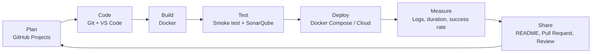

# Lab 2: Thiết lập môi trường DevOps và áp dụng nguyên tắc CALMS

**Sinh viên:** dtc235180136  
**Môn học:** DevOps và các nguyên tắc cốt lõi  
**Chủ đề:** Automation, Lean, Docker và DevOps toolchain  
**Nền tảng kiểm thử:** Windows 10/11, PowerShell, Git, Docker Desktop  

> Bài làm được xây dựng theo hướng dẫn Lab 2. Mã nguồn có thể chạy độc lập bằng Docker và có CI smoke test trên GitHub Actions.

## 1. Mục tiêu

- Chuẩn hóa các công cụ cơ bản cho quy trình DevOps.
- Tự động hóa việc kiểm tra toolchain bằng PowerShell hoặc Bash.
- Đóng gói ứng dụng Node.js trong Docker để loại bỏ khác biệt giữa các máy.
- Sử dụng GitHub Actions để tự động build và kiểm tra container.
- Liên hệ các hoạt động thực hành với năm trụ cột CALMS.

## 2. Cấu trúc bài nộp

```text
.
├── .github/workflows/ci.yml  # CI: kiểm tra metadata, build và smoke test Docker
├── .dockerignore              # Loại bỏ file không cần đưa vào image
├── Dockerfile                 # Image Node.js 20 Alpine, chạy non-root
├── README.md                  # Báo cáo Lab 2
├── devops-check.ps1           # Script kiểm tra toolchain trên PowerShell
├── devops-check.sh            # Script kiểm tra toolchain trên Bash
├── docker-compose.yml         # Khởi chạy ứng dụng bằng Compose
├── package.json               # Metadata và lệnh start
└── server.js                  # HTTP server trả về JSON
```

## 3. Kết quả kiểm tra toolchain

| Công cụ | Yêu cầu | Kết quả trên máy thực hiện bài |
|---|---|---|
| Git | >= 2.40 | Git 2.56.0 hoạt động |
| Docker Desktop | >= 24.x | Chưa có trong PATH tại thời điểm kiểm tra |
| Docker Compose | V2 | Chưa có trong PATH tại thời điểm kiểm tra |
| Node.js | >= 20 | Chưa có trong PATH tại thời điểm kiểm tra |
| VS Code CLI | Bản mới | Chưa có trong PATH tại thời điểm kiểm tra |

Script kiểm tra được cung cấp để chạy lại sau khi cài đặt:

```powershell
.\devops-check.ps1
```

Hoặc trên Git Bash/WSL:

```bash
bash devops-check.sh
```

Để hoàn thiện môi trường Windows, cài Docker Desktop, bật WSL 2 và bật WSL integration trong Docker Desktop. Sau đó mở lại terminal và chạy script kiểm tra một lần nữa.

## 4. Automation - giải pháp giảm thời gian onboarding

### Bài toán

Một team 5 người phải cài Node.js và dependency thủ công. Mỗi thành viên mới mất khoảng 2 giờ để có môi trường chạy được.

### Giải pháp

Bài làm tự động hóa theo ba lớp:

1. `devops-check.ps1`/`devops-check.sh` kiểm tra nhanh các công cụ cần thiết.
2. `Dockerfile` cố định Node.js 20 Alpine và cách chạy ứng dụng, vì vậy máy host không cần cài Node.js để chạy demo.
3. `.github/workflows/ci.yml` tự động build image và gọi endpoint sau mỗi lần push hoặc pull request.

Quy trình onboarding sau khi cài Docker Desktop:

```powershell
.\devops-check.ps1

docker compose up --build -d
Invoke-RestMethod http://localhost:3000
docker compose down
```

Mục tiêu là biến nhiều bước cài đặt thủ công thành vài lệnh có thể lặp lại và kiểm chứng được.

## 5. Lean - đóng gói bằng Docker

Ứng dụng trả về JSON gồm thông điệp, tên lab, timestamp, phiên bản Node.js và platform. Image dùng `node:20-alpine`, đặt `WORKDIR`, khai báo `PORT=3000` và chạy bằng user `node` thay vì root.

### Chạy bằng Docker Compose

```powershell
docker compose up --build -d
Invoke-RestMethod http://localhost:3000
docker compose down
```

### Chạy bằng Docker CLI

```powershell
docker build -t devops-lab2-app .
docker run -d -p 3000:3000 --name lab2-app devops-lab2-app
Invoke-RestMethod http://localhost:3000
docker rm -f lab2-app
```

Kết quả mong đợi có dạng:

```json
{
  "message": "Hello from Docker!",
  "lab": "DevOps Lab 2 - Lean Principle",
  "timestamp": "2026-...",
  "node_version": "v20...",
  "platform": "linux"
}
```

### So sánh trước và sau

| Cách làm thủ công | Cách làm Lean với Docker |
|---|---|
| Mỗi máy tự cài một phiên bản Node.js | Phiên bản Node.js được cố định trong image |
| Dependency và cấu hình dễ khác nhau | Mọi người dùng cùng Dockerfile |
| Mất nhiều thời gian hướng dẫn người mới | `docker compose up --build` có thể lặp lại |
| Khó tái hiện lỗi giữa Windows và Linux | Container cung cấp môi trường Linux nhất quán |

## 6. DevOps toolchain map



| Giai đoạn | Công cụ trong bài | Mục đích |
|---|---|---|
| Plan | GitHub Projects/Issues | Chia nhỏ task và theo dõi tiến độ |
| Code | Git, GitHub, VS Code | Quản lý phiên bản và chỉnh sửa mã nguồn |
| Build | Docker | Tạo image có môi trường chạy cố định |
| Test | curl, GitHub Actions | Kiểm tra endpoint sau khi container khởi động |
| Deploy | Docker Compose | Khởi chạy ứng dụng bằng cấu hình có version |
| Measure | Logs, CI duration, smoke-test result | Đo kết quả và phát hiện lỗi sớm |
| Share | README, commit, pull request | Chia sẻ cách chạy và kiến thức |

## 7. CALMS self-assessment

| Trụ cột | Điểm | Nhận xét |
|---|---:|---|
| Culture | 3/5 | Đã mô tả quy trình có thể dùng chung, chưa có team review thực tế |
| Automation | 4/5 | Có script kiểm tra và GitHub Actions build/smoke test |
| Lean | 4/5 | Dockerfile và Compose giúp môi trường nhất quán, còn phụ thuộc Docker Desktop |
| Measurement | 3/5 | Có kết quả smoke test và log, chưa có dashboard/alert thời gian thực |
| Sharing | 4/5 | README, script và workflow có thể chia sẻ trực tiếp trong repository |
| **Tổng** | **18/25** | **Mức: Khá - cần cải thiện đo lường và phối hợp nhóm** |

### Ba hành động cải thiện

1. Thêm test tự động cho các trường hợp HTTP khác nhau và lưu kết quả vào CI artifact.
2. Thêm health check, theo dõi thời gian build và tỷ lệ workflow thành công theo tuần.
3. Thực hiện pull request review với checklist, ghi lại vấn đề và cách khắc phục sau mỗi lần triển khai.

## 8. CI/CD

Workflow `.github/workflows/ci.yml` thực hiện:

1. Checkout mã nguồn.
2. Thiết lập Node.js 20.
3. Kiểm tra metadata `package.json`.
4. Build Docker image.
5. Chạy container.
6. Gọi `http://localhost:3000` và xác nhận chuỗi `Hello from Docker`.
7. Dọn dẹp container kể cả khi bước kiểm thử thất bại.

## 9. Minh chứng cần bổ sung khi trình bày

Khi Docker Desktop đã được cài đặt và chạy, chụp màn hình các kết quả sau và đính kèm vào phần nộp bài nếu giảng viên yêu cầu:

- Kết quả `devops-check.ps1` hiển thị version Git, Docker, Node.js và VS Code.
- Kết quả `docker build` và `docker image ls`.
- Kết quả `Invoke-RestMethod http://localhost:3000`.
- Workflow `Lab 2 CI` màu xanh trên tab Actions của GitHub.

## 10. Kết luận

Bài thực hành cho thấy CALMS không chỉ là lý thuyết: Automation biến các bước lặp lại thành script/CI; Lean loại bỏ khác biệt môi trường bằng container; Measurement dựa vào smoke test và log; Sharing thể hiện qua README và repository; Culture được hỗ trợ bởi quy trình làm việc chung. Mô hình này là nền tảng để mở rộng sang test, security scan và deployment ở các lab tiếp theo.
